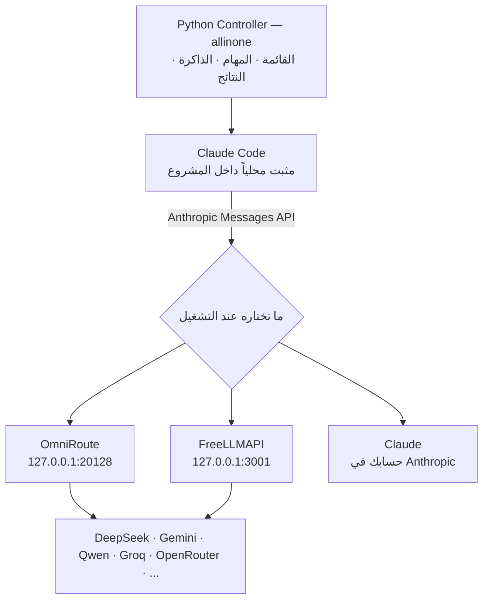

# Allinone — Claude Code + OmniRoute + FreeLLMAPI + Claude

برنامج واحد يثبّت المكونات ويربطها ببعض:

- **Claude Code** هو أداة البرمجة التي تنفّذ المهام.
- **OmniRoute** و**FreeLLMAPI** بوابتان توصلان Claude Code بنماذج مثل DeepSeek وGemini وQwen وغيرها.
- **Claude** هو الخيار الثالث: Claude Code يتصل بـ Anthropic مباشرة بحسابك الأصلي.

تختار عند كل تشغيل مصدر النموذج، من **واجهة رسومية** تشبه واجهة Claude أو من الطرفية، وClaude Code هو من ينفّذ في كل الحالات. يدير ذلك كله **Python Controller** فيه قائمة ومهام وذاكرة، وكل جزء قابل للتعديل والإضافة.



## ما الذي يفعله

- **تثبيت كامل بأمر واحد**:
  - ينزّل نسخة محمولة من Node.js 24، وهو الإصدار الوحيد المتوافق مع البوابتين معاً. يتحقق من بصمتها، ولا يغيّر Node المثبت على جهازك.
  - يثبّت OmniRoute وFreeLLMAPI وClaude Code داخل مجلد `runtime/`.
- **اختيار البوابة عند التشغيل**:
  - يشغّل البوابة في الخلفية وينتظر حتى تجهز.
  - يقرأ مفتاحها تلقائياً.
  - يطلق Claude Code متصلاً بها، ثم يوقفها عند الخروج.
- **أدوات إضافية داخل Claude Code**:
  - ذاكرة دائمة مشتركة بين كل الجلسات والبوابات.
  - أداة `ask_model` لاستشارة نموذج آخر.
  - معلومات البوابة ونماذجها.
  - وكيل لمراجعة الكود.
  - أوامر `/allinone:...`.
- **مهام بدون واجهة**: `allinone run "..."` وطابور مهام، والنتائج محفوظة في قاعدة بيانات.
- **حرية تعديل كاملة**:
  - إعدادات بتعليقات عربية.
  - أدوات Python تكتبها بدالة واحدة.
  - Skills وAgents وHooks.
  - خوادم MCP، ومنها أدوات البوابتين نفسيهما.
  - تعديل الكود المصدري للبوابات مع الاحتفاظ بتعديلاتك عند التحديث.
  - إضافة بوابة ثالثة.

## المتطلبات

| | |
|---|---|
| النظام | Windows 10/11، macOS 13 أو أحدث، Linux (Ubuntu 20.04+ وDebian 10+) |
| Python | 3.10 أو أحدث (يعرض المثبّت على Windows تثبيته تلقائياً) |
| Git | مطلوب (يعرض المثبّت على Windows تثبيته تلقائياً) |
| Node.js | **لا تحتاج تثبيته**، فالبرنامج ينزّل نسخته الخاصة |
| المساحة | حوالي 2 إلى 3 GB |
| الذاكرة | 4 GB أو أكثر، و8 GB أو أكثر إن أردت بناء OmniRoute من الكود المصدري |

## التثبيت

### Windows

```powershell
git clone https://github.com/baghdadhost-wq/Allinone.git
cd Allinone
.\install.cmd
```

> في PowerShell يجب كتابة `.\` قبل اسم الملف (`.\install.cmd` و`.\allinone.cmd`)، لأن PowerShell لا يشغّل الملفات من المجلد الحالي بدونها. في نافذة cmd العادية يكفي `install.cmd`.

يفحص `install.cmd` وجود Python وGit، ويعرض تثبيتهما عبر `winget` إن لم يجدهما. بعدها ينزّل Node.js وOmniRoute وFreeLLMAPI وClaude Code، ثم يسألك إن كنت تريد إضافة `allinone` إلى PATH.

### macOS / Linux

```bash
git clone https://github.com/baghdadhost-wq/Allinone.git
cd Allinone
./install.sh
```

> المستودع خاص، لذا يطلب `git clone` تسجيل الدخول إلى GitHub. الطريقة الأسهل هي `gh auth login` أو GitHub Desktop.

## التشغيل

```bash
.\allinone.cmd   # على Windows (أو allinone فقط بعد إضافته إلى PATH وفتح طرفية جديدة)
./allinone        # على macOS / Linux
```

تظهر قائمة البوابات مع حالة كل منها:

```
  1) OmniRoute    ● يعمل     http://127.0.0.1:20128
  2) FreeLLMAPI   ○ متوقف    http://127.0.0.1:3001

  p) المشروع   d) لوحة التحكم   s) الحالة   t) المهام   i) تثبيت/تحديث   l) اللغة   q) خروج
اختر البوابة لـ Claude Code [1]:
```

اختر رقم البوابة، ثم اكتب النموذج أو اضغط Enter للافتراضي (`?` تعرض قائمة النماذج). يفتح بعدها Claude Code في مجلد المشروع متصلاً بالبوابة المختارة. عند خروجك من Claude Code تعود إلى القائمة.

يعمل Claude Code على المجلد الذي شغّلت منه `allinone`، ويمكنك تغييره من القائمة بالحرف `p`، أو بالأمر `allinone start omniroute -p D:\my-project`.

### أول مرة مع Claude (حسابك الأصلي)

نفّذ `allinone login` (أو زر «تسجيل الدخول» في الواجهة)، وسجّل الدخول في المتصفح. يُحفظ تسجيل الدخول داخل Allinone (`data/claude-home`)، منفصلاً عن أي Claude Code آخر على جهازك. الاستهلاك يُحسب على اشتراكك أو رصيدك في Anthropic.

### أول مرة: أضف مزوّداً واحداً على الأقل

البوابتان لا تملكان أي نموذج حتى تضيف مفتاح مزوّد واحد على الأقل، مثل Gemini أو Groq أو OpenRouter أو DeepSeek.

**OmniRoute**
1. نفّذ `allinone dashboard omniroute`، أو اختر `d` من القائمة.
2. سجّل الدخول بكلمة المرور التي يعرضها البرنامج. هي محفوظة في `data/secrets.json`، ويمكنك تغييرها من Settings → Security.
3. من **Providers** أضف مفاتيح مزوديك، أو سجّل الدخول بحساباتك.
4. اختر OmniRoute من القائمة. يستخدم Claude Code النموذج `auto`، أي أن OmniRoute يختار أفضل مزوّد متاح ويتحول تلقائياً عند الفشل.

**FreeLLMAPI**
1. نفّذ `allinone dashboard freellmapi`.
2. في أول زيارة أنشئ حساب لوحة التحكم، وهو محلي على جهازك.
3. من صفحة **Keys** أضف مفاتيح المزودين، ورتّب **Fallback Chain** كما تريد.
4. اختر FreeLLMAPI من القائمة. يقرأ Allinone المفتاح الموحّد `freellmapi-…` تلقائياً، فلا حاجة لنسخه.

## الواجهة الرسومية

```powershell
.\gui.cmd              # Windows (أو انقر عليه مرتين)، أو: .\allinone.cmd gui
./gui                  # macOS / Linux
```

تفتح في المتصفح على `127.0.0.1` (جهازك فقط) بواجهة تشبه Claude:

- **اختيار المصدر من الأعلى**: OmniRoute أو FreeLLMAPI أو Claude، مع نقطة تبيّن الحالة (أخضر: جاهز، رمادي: متوقف، أحمر: غير مثبت، برتقالي: Claude غير مسجّل الدخول). Claude Code ينفّذ كل رسالة داخل مجلد المشروع في كل الحالات.
- **🧠 التفكير بعمق**: يضع سؤالك داخل قالب التفكير العميق ويرسله. أنت ترى سؤالك فقط. القالب في `config/prompts/deep_thinking.txt` ويمكنك تعديله.
- **📝 Memory**: يحفظ المحادثة كاملة في ملف txt (داخل `data/conversations/`) ويرسلها مع سؤالك، وأنت ترى سؤالك فقط. مفيد خصوصاً عند الانتقال من بوابة لأخرى داخل المحادثة نفسها.
- **👁 إظهار ما يحدث فعلياً**: مفعّل = كل ما يحدث: النص المرسل كاملاً، والأدوات والأوامر ونتائجها، وجولات التحقق، والتجربة الفعلية وصورها، والتنبيهات، والمتابعات التلقائية. غير مفعّل (الافتراضي) = الطلبات والأجوبة فقط، مع سطر صغير أثناء العمل يذكر الخطوة الحالية، وتبقى بطاقات الإذن والإيقاف ظاهرة لأنها تحتاج قراراً منك.
- **⏻ تشغيل/إيقاف البوابة**: زر بجانب «لوحة التحكم» يشغّل البوابة المختارة أو يوقفها لتوفير الذاكرة. وزر «⏻ إغلاق Allinone» أسفل القائمة الجانبية يغلق البرنامج كله، ويوقف البوابات التي شغّلها.
- **تسجيل الدخول إلى Claude**: اختر Claude ثم زر «تسجيل الدخول»، فتفتح نافذة تسجيل الدخول إلى حسابك (اشتراك Claude أو Anthropic Console).
- **🧾 تقرير الأخطاء** (أعلى الصفحة): يجمع في ملف txt طلبك وكل خطوة جرّبها Claude Code (الأداة، مدخلاتها، نتيجتها، والفاشلة منها معلّمة ✘) وقرارات الإذن وملخصاً للأخطاء. ويذكر أيضاً **الأوقات**: متى أُرسل كل أمر، ومتى اكتمل ومدة تنفيذه، ومتى صدرت كل إجابة، وكم انتظر النموذج/البوابة قبل كل رد. ثم يقسّم وقت كل رد إلى «عمل» (كتابة الكود وتنفيذ الأوامر) و«انتظار» (بطء البوابة أو المزوّد بين الأوامر) و«انتظار إذنك»، ويعلّم الانتظار الطويل وتوقف البث في منتصف الرد، ويعطي حكماً: هل التأخير كان عملاً أم بطئاً. يُحفظ في `data/reports/`، ويمكنك تنزيله أو نسخه لتلصقه في نموذج أذكى (مثل Claude.ai)، أو «إرسال إلى نموذج آخر» فيُرفق بمحادثة جديدة على البوابة التي تختارها. رأس التقرير (ما يُطلب من النموذج) في `config/prompts/report_header.txt`.
- **📥 رفع إجابة**: الصق الإجابة التي حصلت عليها، أو اختر ملف txt/md، مع ملاحظة اختيارية، فتُرسل إلى المحادثة الحالية مع طلب أن يتحقق Claude Code منها ثم يطبّقها على المشروع. في المحادثة تظهر ملاحظتك فقط، والإجابة كاملة تظهر مع «إظهار ما يحدث فعلياً». القالب في `config/prompts/expert_answer.txt`.
  الطريقة المقترحة: 🧾 تقرير ← نموذج أذكى ← 📥 رفع الإجابة ← Claude Code ينفّذ.
- **🔒/🔓 إذن مسبق** (أعلى الصفحة): فعّله قبل أن يطلب Claude Code الإذن، فيُسمح تلقائياً بطلباته في هذه المحادثة دون بطاقة سؤال، ويظهر سطر صغير «سُمح تلقائياً» لكل طلب. إذا لم تفعّله تظهر بطاقة الإذن كالمعتاد. وإذا فعّلته وبطاقة تنتظر، يُسمح بها فوراً. يبقى الإذن المسبق ما دامت نافذة Allinone مفتوحة.
- **📂 المشاريع** (تبويب «المشاريع» في القائمة الجانبية، مثل مشاريع Claude): لكل مشروع اسم ووصف و**تعليمات** تُرسل إلى Claude Code في كل محادثة داخله، و**ملفات معرفة** (مستندات، أكواد...) يقرأ منها، و**مجلد عمل** خاص، وبوابة ونموذج افتراضيان، و**محادثاته** الخاصة. افتح المشروع ثم «+ محادثة جديدة في المشروع». الملفات في `data/projects/<رقم>/files/`.
- **مميزات أخرى**:
  - الردود تظهر أثناء كتابتها، مع زر إيقاف.
  - بطاقات تعرض كل أداة يستخدمها Claude Code (تعديل ملف، أمر طرفية...) ونتيجتها.
  - سجل محادثات مع بحث وإعادة تسمية وحذف وتصدير Markdown، والمحادثة تستمر في الجلسة نفسها.
  - اختيار النموذج والجهد (effort) والصلاحيات لكل رسالة.
  - إرفاق ملفات وصور حتى 200 MB (الحد قابل للتغيير من `gui.max_upload_mb`)، ونسخ الكود بزر، وحفظ أي رد في الذاكرة الدائمة.
  - وضع ليلي ونهاري، وعربي وإنجليزي.

> **الصلاحيات في الواجهة**: عندما يحتاج Claude Code إذناً (مثل تشغيل أمر في الطرفية)، تظهر بطاقة 🔐 فيها الأمر وثلاثة أزرار: «سماح» أو «سماح دائماً في هذه المحادثة» أو «رفض». «تعديل الملفات تلقائياً» (الافتراضي) يعدّل الملفات دون سؤال ويسألك عن الباقي. «الافتراضي» يسألك عن كل تعديل أيضاً. «كل شيء بلا سؤال ⚠» لا يسأل أبداً، فاستخدمه في مجلد تثق به فقط.

## الأوامر

| الأمر | الوظيفة |
|---|---|
| `allinone` | القائمة التفاعلية |
| `allinone gui` | الواجهة الرسومية |
| `allinone omniroute` / `allinone freellmapi` / `allinone claude` | تشغيل Claude Code مباشرة في الطرفية |
| `allinone login` / `logout` / `auth` | تسجيل الدخول إلى حساب Claude والخروج منه وعرض الحالة |
| `allinone start freellmapi -m <model> -p <folder> -- --continue` | مع نموذج ومجلد، وما بعد `--` يذهب إلى Claude Code |
| `allinone run "اكتب اختبارات لملف utils.py"` | تنفيذ مهمة بلا واجهة وحفظ النتيجة (`-g` لاختيار البوابة) |
| `allinone run --resume 3 "أكمل"` | متابعة جلسة المهمة رقم 3 |
| `allinone task add "..."` ثم `allinone task work` | طابور مهام يُنفَّذ بالترتيب |
| `allinone task list` / `allinone task show 3` | عرض المهام ونتائجها |
| `allinone memory add "..."` / `search` / `list` / `forget` | الذاكرة المشتركة (يستخدمها Claude أيضاً) |
| `allinone gateway start\|stop\|status\|logs [name]` | التحكم بالبوابات وسجلاتها (`logs -f` للمتابعة) |
| `allinone dashboard [name]` | فتح لوحة تحكم البوابة |
| `allinone models [name]` | عرض النماذج المتاحة |
| `allinone key <name> [KEY]` | عرض أو حفظ مفتاح بوابة |
| `allinone install [all\|node\|claude\|omniroute\|freellmapi]` | التثبيت |
| `allinone update [...] [--latest]` | التحديث |
| `allinone customize save\|status\|diff <gateway>` | حفظ تعديلاتك على كود البوابة |
| `allinone doctor` | فحص كل شيء |
| `allinone lang ar\|en` | لغة الواجهة |

## داخل Claude Code

| | |
|---|---|
| `/allinone:remember <نص>` | حفظ معلومة في الذاكرة الدائمة |
| `/allinone:recall <كلمات>` | البحث في الذاكرة |
| `/allinone:gateway` | البوابة والنموذج الحاليان وقائمة النماذج |
| `/model <id>` | تغيير النموذج أثناء الجلسة |
| `@agent-allinone:reviewer` | مراجعة التغييرات الأخيرة |
| أدوات MCP | `memory_save` · `memory_search` · `ask_model` · `gateway_models` · `task_list` · … وكل ما تضيفه في `claude/mcp/tools/` |

## التخصيص

كل ما يلي في ملفات يمكنك تعديلها، والتفاصيل والأمثلة في **[docs/CUSTOMIZE.md](docs/CUSTOMIZE.md)**:

| ماذا | أين |
|---|---|
| المنافذ، النموذج لكل بوابة، الإصدارات، طريقة التثبيت | `config/allinone.jsonc` (إعداداتك الشخصية في `config/local.jsonc`) |
| خيارات البوابة الأصلية (ضغط السياق، طلب مفتاح...) | `config/gateways/omniroute.env` · `config/gateways/freellmapi.env` |
| أدوات Python جديدة لـ Claude | ملف `.py` في `claude/mcp/tools/` |
| خوادم MCP (ومنها أدوات OmniRoute وFreeLLMAPI نفسيهما) | `config/mcp.jsonc` |
| Skills وأوامر وAgents | `claude/plugins/allinone/`، أو أي مجلد plugin جديد في `claude/plugins/` |
| Hooks والصلاحيات وإعدادات Claude Code | `claude/settings.json` |
| التعليمات التي يتلقاها Claude في بداية كل جلسة | `claude/context.md` |
| قالب «التفكير بعمق» وقالب Memory في الواجهة | `config/prompts/` |
| منفذ الواجهة وصلاحيتها الافتراضية | قسم `gui` في `config/allinone.jsonc` |
| تعديل الكود المصدري لـ OmniRoute أو FreeLLMAPI | `runtime/<gateway>/`، ثم `allinone customize save`، وتُحفظ التعديلات في `customizations/` |
| بوابة ثالثة (LiteLLM، claude-code-router، خادم آخر...) | قسم `gateways` في `config/allinone.jsonc` بالنوع `custom` |

## هيكل المستودع

```
allinone.py · allinone.cmd · allinone     نقطة التشغيل
gui.cmd · gui                             الواجهة الرسومية
install.cmd · install.ps1 · install.sh    المثبّتات
controller/          Python Controller (القائمة، البوابات، Claude Code، المهام، الذاكرة، الواجهة web/)
config/              الإعدادات (allinone.jsonc · mcp.jsonc · gateways/*.env · prompts/)
claude/              تخصيص Claude Code: settings.json · context.md · hooks/ · mcp/ · plugins/
customizations/      تعديلاتك على كود البوابتين (ملفات patch)
docs/                الشرح التفصيلي
tests/               اختبارات تلقائية (python -m unittest discover -s tests)
runtime/   ← غير محفوظ في git: Node.js والبوابتان وClaude Code المثبتة
data/      ← غير محفوظ في git: قواعد البيانات والسجلات والأسرار والذاكرة
```

## التحديث

```bash
git pull                      # تحديث Allinone نفسه
allinone update               # إعادة تثبيت المكونات بالإصدارات المحددة في الإعدادات
allinone update omniroute --latest
```

إصدارات البوابتين مثبّتة في `config/allinone.jsonc`، ما يضمن أن ما يعمل اليوم يبقى يعمل. لرفعها عدّل `version` أو `ref` هناك، أو استخدم `--latest`. تعديلاتك على الكود المصدري تُطبَّق تلقائياً بعد كل تحديث.

## الحذف (إلغاء التثبيت)

كل ما يثبّته Allinone موجود داخل مجلده فقط: Node.js والبوابتان وClaude Code في `runtime/`، والبيانات في `data/`. لا يثبّت شيئاً في النظام، لذا يكفي حذف المجلد. الخطوات:

**1. أوقف البوابات إن كانت تعمل:**

```powershell
.\allinone.cmd gateway stop omniroute
.\allinone.cmd gateway stop freellmapi
```

**2. احذف Allinone من PATH** (فقط إن وافقت على إضافته أثناء التثبيت). نفّذ في PowerShell عادي:

```powershell
$p = [Environment]::GetEnvironmentVariable("Path", "User")
[Environment]::SetEnvironmentVariable("Path", (($p -split ";") | Where-Object { $_ -and $_ -notlike "*\Allinone" }) -join ";", "User")
```

**3. احذف المجلد.** اخرج منه أولاً، وأغلق أي برنامج يستخدمه (مثل VS Code)، ثم:

```powershell
cd $HOME
Remove-Item -Recurse -Force "$HOME\Allinone"
```

على macOS / Linux:

```bash
./allinone gateway stop omniroute; ./allinone gateway stop freellmapi
cd ~ && rm -rf ~/Allinone
rm -f ~/.local/bin/allinone      # إن كنت أنشأت هذا الاختصار
```

> **تنبيه:** حذف المجلد يحذف أيضاً `data/`، وفيه مفاتيح المزودين وكلمات مرور لوحات التحكم والذاكرة والمهام. إن أردت الاحتفاظ بها فانسخ المجلد `data` إلى مكان آخر أولاً، ثم ضعه في المجلد الجديد بعد إعادة التثبيت.

**حذف التثبيت فقط مع الإبقاء على بياناتك وإعداداتك:** احذف المجلد `runtime` وحده، وعند الحاجة أعد التثبيت بالأمر `.\install.cmd`.

**إن كان المجلد داخل `C:\Windows\System32`** (يحدث عند تنزيله من PowerShell يعمل كمسؤول): افتح PowerShell **كمسؤول** وانسخ هذا المسار حرفياً دون أي تغيير:

```powershell
Remove-Item -Recurse -Force C:\Windows\System32\Allinone
```

## ⚡ السرعة مع البوابات المجانية

البطء بين الأوامر مع FreeLLMAPI وOmniRoute سببه غالباً ثلاثة أشياء: نماذج صالحة قليلة، وطلبات تكبر مع المحادثة، وأوامر لا تنتهي. الأدوات التالية تعالجها:

- **🔑 المفاتيح** (يظهر عند اختيار FreeLLMAPI):
  - عدد النماذج الصالحة لديك الآن، أي التي تدعم الأدوات ولها مفتاح.
  - زر **«⚡ تفعيل المزوّدين الذين لا يحتاجون مفتاحاً»**: ميزة FreeLLMAPI نفسها، لا تحتاج أي حساب.
  - قائمة المزوّدين مرتبة حسب عدد نماذجهم التي تدعم الأدوات، مع زر يفتح صفحة إنشاء المفتاح، وخانة تلصق فيها المفتاح فيُضاف مباشرة.
  - حساب لوحة FreeLLMAPI: في التثبيت الجديد يُنشئه Allinone بنفسه. إذا كنت أنشأته سابقاً، تكتب بريده وكلمة مروره مرة واحدة.
- **⚡ الأسرع مع الأدوات** (من قائمة النماذج في FreeLLMAPI):
  - يختار Allinone أسرع نموذج صالح يدعم الأدوات وسياقه 32 ألف توكن على الأقل.
  - إذا وصل ذلك النموذج حده (429) يُريحه 5 دقائق وينتقل فوراً إلى الأسرع التالي.
  - في OmniRoute تظهر `auto/coding` و`auto/fast`، وهي combos جاهزة فيه تتنقل بين المزوّدين وحدها.
- **طلبات أصغر:**
  - يُخبَر smarter Code بحجم سياق نماذج البوابة (`CLAUDE_CODE_MAX_CONTEXT_TOKENS`)، فيضغط المحادثة قبل أن ترفضها البوابة لأنها كبيرة.
  - تُقص مخرجات الأوامر الطويلة إلى 12,000 حرف.
  - عندما تكبر المحادثة تظهر بطاقة «↪ محادثة جديدة تكمل من هنا»: محادثة جديدة تبدأ بملف تسليم للقديمة.
  - الإعدادات في `gui.context`.
- **أوامر الخوادم:**
  - أدوات `app_start` و`app_logs` و`app_stop` تشغّل البرنامج في الخلفية مرة واحدة وتعيد رابطه، وتوقفه عند نهاية الجلسة.
  - قاعدة دائمة للنموذج (`config/prompts/run_rules.txt`) تمنع تشغيل الخوادم في المقدمة، لأن الأمر عندها ينتظر مهلته كاملة.
- **💬 سؤال سريع** (زر بجانب حقل الكتابة، غير مفعّل افتراضياً):
  - يُرسل السؤال إلى البوابة مباشرة مثل playground، دون smarter Code ودون أدوات. لذلك يكون الجواب سريعاً جداً ويظهر حرفاً حرفاً.
  - يرسل معه آخر المحادثة (حتى 24 ألف حرف) وتعليمات المشروع والملفات النصية الصغيرة المرفقة.
  - **لا** يقرأ ملفات المشروع ولا ينفّذ أوامر ولا يعدّل شيئاً. للعمل على المشروع أطفئه.
  - مع حساب Claude (بلا مفتاح API) يعمل عبر smarter Code لكن دون أي أداة.
  - الإعدادات في `gui.quick`، والتعليمات في `config/prompts/quick_system.txt`.
- **🪶 وضع خفيف** (زر، غير مفعّل افتراضياً):
  - smarter Code بأدوات أساسية فقط: `Bash,Read,Edit,Write,Glob,Grep`، ودون خوادم MCP والإضافات والطلبات الجانبية (مثل طلب عنوان المحادثة).
  - يحدد مخرجات النموذج بـ 8192 توكن، لأن نماذج مجانية كثيرة ترفض 32000 (الافتراضي).
  - كل طلب أصغر بكثير، فتجيب البوابات المجانية أسرع وتصل حدودها أبطأ. لكنه بلا تجربة فعلية بالمتصفح ولا وكلاء فرعيين.
  - الإعدادات في `gui.light`.
- **انتظار ذكي عند 429:** يقرأ Allinone وقت تجدد الحد من رسالة البوابة (مثل «Soonest reset ~5m») وينتظره بالضبط.
- **↪ تحويل تلقائي** (زر، غير مفعّل افتراضياً):
  - إذا نفدت كل نماذج البوابة أو توقفت، ينتقل العمل إلى البوابة التالية مع ملف تسليم.
  - الترتيب في `gui.failover.order`، والافتراضي FreeLLMAPI ثم OmniRoute ثم Claude.
- **🧾 التقرير:**
  - **تشخيص البوابة:** عدد رفضات 429، والنماذج بلا مفتاح أو بلا دعم للأدوات، والأوامر التي شُغّلت في المقدمة. مع الحل لكل منها.
  - **تنبيه** عندما ترسل البوابة الرد دفعة واحدة، أي أن «الانتظار» يشمل وقت الكتابة.
  - خيار **«تقرير مختصر»**: الأخطاء وما قبلها فقط، فيستهلك توكنز أقل.

## 🏷 الاسم الظاهر (smarter)

يظهر الاسم **smarter** بدل «Claude» و«Anthropic» في:
- الواجهة وأزرارها، ورسائل البرنامج في الطرفية.
- أسماء البوابات، وأسماء النماذج: `claude-sonnet-4-5` تظهر `smarter-sonnet-4-5`.
- الأجوبة المعروضة، وتقرير الأخطاء، والمحادثات المصدّرة.

لتغيير الاسم أو إظهار الاسم الحقيقي: `"branding": { "name": "smarter" }` في `config/allinone.jsonc`. اكتب اسماً آخر، أو اتركه فارغاً `""`.

**ما لا يتغير** (يجب أن يبقى كما هو ليعمل البرنامج):
- الأوامر: `allinone install claude` و`allinone login`.
- برنامج `claude` نفسه، ومجلدات `claude/`.
- رابط الموقع claude.ai.
- النماذج: يُرسل إليها الاسم الحقيقي في الخلفية، والاسم الظاهر للعرض فقط.
- هذا الملف وملفات التوثيق، لأنها تشرح الأوامر الحقيقية.
- ملف التراخيص `THIRD_PARTY_NOTICES.md`: يُبقي الاسم الحقيقي لأنه مطلوب قانونياً.

## 👤 أكثر من حساب Claude (Pro وما فوق)

عند اختيار **Claude** تظهر قائمة الحسابات بجانب زر الدخول. من القائمة:
- **«➕ إضافة حساب…»:** أضف ما تشاء من الحسابات.
- **الدخول:** لكل حساب تسجيل دخوله الخاص، لأن لكل حساب مجلد إعدادات Claude Code منفصلاً في `data/claude-accounts/`.
- **الاختيار:** اختر الحساب لكل محادثة.

المشاريع لا تُحفظ في أي حساب:
- الملفات في مجلداتك، والمحادثات في `data/allinone.db` على جهازك.
- إذا غيّرت الحساب داخل محادثة، تبدأ جلسة جديدة على الحساب الجديد مع **ملف تسليم** يلخص ما أُنجز، فيكمل العمل من حيث توقف.
- حذف الحساب يسجّل خروجه فقط، ولا يمس المشاريع أو المحادثات.

## 🌐 Claude.ai يدوي (أي حساب، والمجاني أيضاً)

Claude Code لا يعمل مع الحساب المجاني. وشروط Claude.ai لا تسمح بأن يتحكم برنامج بالموقع آلياً. لذلك هذا الخيار يجعل **التنفيذ على جهازك**، و**الموقع تستخدمه أنت بيدك**:

1. اختر **«🌐 Claude.ai يدوي»** واكتب طلبك. يجهّز Allinone طلباً كاملاً فيه:
   - كيف يكتب Claude ردّه.
   - ملف التسليم: ما أُنجز حتى الآن.
   - شجرة الملفات.
   - محتوى الملفات المهمة: الملفات المذكورة في طلبك، ثم ما عدّلته الردود السابقة، ثم البقية حتى حد `gui.bridge.max_chars`.
   - نتيجة آخر تحقق على جهازك.
2. **«📋 نسخ وفتح Claude.ai»:** الصق الطلب في أي حساب. إذا كان الطلب كبيراً فنزّله كملف وأرفقه بدل لصقه.
3. **الصق الجواب** في Allinone ثم «معاينة التغييرات»: ترى كل ملف (جديد، أو تعديل مع عدد الأسطر، أو حذف). المسارات خارج المشروع تُرفض.
4. **«تطبيق على المشروع»:**
   - تُكتب الملفات التي اخترتها، مع نسخة احتياطية للتراجع (زر «↩ تراجع»).
   - مع «🔁 تحقق وأصلح» و«👁 تجربة فعلية» يُشغَّل التحقق والتجربة على جهازك، وتُضاف نتيجتهما إلى الطلب التالي تلقائياً.
   - الأوامر التي يقترحها الرد تظهر بزر «▶ تشغيل».

كل طلب يُبنى من جديد من ملفاتك، فلا شيء محفوظ على جهة Claude. لذلك تستطيع أن تكمل المشروع نفسه من حساب آخر في أي وقت، بنسخ الطلب التالي إليه.

## 🔁 تحقق وأصلح (طريقة عمل Claude لكل النماذج)

Claude يجرّب النتيجة قبل أن يقول «انتهيت»، ويصلح ما يفشل، ويغيّر أسلوبه إذا لم ينجح. النماذج الأخرى عبر OmniRoute وFreeLLMAPI كثيراً ما تتوقف مبكراً، أو تدّعي النجاح دون تجربة، أو تكرر الإصلاح الخاطئ نفسه. زر **🔁 تحقق وأصلح** (مفعّل افتراضياً) يفرض هذه الطريقة على أي نموذج بثلاث طبقات:

1. **طريقة العمل**: تُضاف إلى تعليمات Claude Code في كل تشغيل (`config/prompts/work_method.txt`): خطة قصيرة، وتجربة كل خطوة، وقراءة الخطأ وإصلاح سببه الجذري، وتغيير الأسلوب بعد فشلين، وعدم ادّعاء النجاح دون دليل.
2. **تحقق آلي لا يعتمد على كلام النموذج**: عندما يقول النموذج إنه انتهى، يشغّل Allinone أمر التحقق بنفسه عبر Stop hook في Claude Code (`claude/hooks/verify_stop.py`).
   - **إذا فشل**: يُمنع الإنهاء، ويُعاد الخطأ إلى النموذج في **الجلسة نفسها** ليصلحه ثم يُتحقق من جديد، حتى 3 جولات.
   - **إذا تكرر الخطأ نفسه**: يُطلب منه صراحة أسلوب مختلف (تتبّع الخطأ، واختبار الافتراضات، والطباعة، والتوثيق، والتراجع عن آخر تغيير، والحل البديل).
3. **النتيجة أمامك**: كل جولة تحقق تظهر مباشرة أثناء العمل، ثم شارة «✔ تم التحقق» أو «✘ فشل التحقق» تحت الرد، وتُكتب في 🧾 تقرير الأخطاء مع أوقاتها.

**أمر التحقق**:
- لكل مشروع حقل «أمر التحقق» في صفحة المشروع، مثل `npm test` أو `pytest` أو `npm run build`.
- يمكن تحديد أمر عام في `gui.verify.command` في الإعدادات.
- إذا لم يُحدَّد أمر، يكتشفه Allinone تلقائياً: npm test/build، وpytest/unittest، وcargo، وgo، وmaven/gradle، وdotnet، وmake test.
- إذا لم يجد شيئاً يطلب من النموذج مرة واحدة أن يجرّب النتيجة بنفسه ويذكر كيف تحقق.
- إذا لم يتغير أي ملف (سؤال عادي) لا يُشغَّل تحقق.

الإعدادات في `gui.verify`: عدد الجولات، ومهلة الأمر، والاكتشاف التلقائي، وطريقة العمل. والنصوص التي تُعاد إلى النموذج في `config/prompts/verify_*.txt`.

## 👁 تجربة فعلية (تشغيل البرنامج وأخذ صور مثل Claude)

لا يكفي أن ينجح الكود في الاختبارات؛ Claude يشغّل البرنامج نفسه ويستخدمه ويأخذ صوراً للمراحل المختلفة. زر **👁 تجربة فعلية** يفعل ذلك مع أي نموذج:

1. **أثناء العمل:** يحصل النموذج على أدوات متصفح: فتح البرنامج، وقراءة الصفحة نصاً (العنوان، والنص الظاهر، والأزرار والحقول ومحدداتها)، والضغط، والكتابة، وأخذ الصور، وقراءة أخطاء console، وتغيير الحجم إلى الهاتف، والتقاط الشاشة لبرامج سطح المكتب. النموذج الذي يرى الصور (مثل Claude) يتلقى الصورة نفسها. أما النماذج النصية فتتلقى وصف الصفحة نصاً ومسار الصورة، لأن كثيراً منها لا يقبل الصور.
2. **قبل الإنهاء:** يشغّل Allinone البرنامج بنفسه.
   - **التشغيل:** يستخدم أمر التشغيل من المشروع، أو يكتشفه تلقائياً: `npm run dev/start`، وDjango، وFlask/FastAPI/Streamlit، أو صفحة `index.html`.
   - **الانتظار:** حتى يعمل البرنامج، ويقرأ رابطه من مخرجاته.
   - **الاستخدام:** ينفّذ السيناريو المكتوب في المشروع، وإن لم يوجد سيناريو يزور الصفحة الرئيسية وبعض روابطها.
   - **الصور:** صورة بعد كل مرحلة، وصورة إضافية بحجم الهاتف.
   - **ما يكتشفه:** الصفحة الفارغة، وأخطاء JavaScript وconsole، والروابط والملفات وطلبات API التي تفشل (404/500)، والبرنامج الذي يتوقف أو لا يعمل أصلاً، والنص المتوقع الذي لم يظهر.
3. **رؤية ثانية:** يراجع الصور نموذج يرى الصور. الافتراضي Claude إن كنت مسجّل الدخول، ويمكن اختيار بوابة ونموذج آخر في `gui.visual.reviewer`. يقرأ كل صورة ويقارنها بطلبك: هل تحقق المطلوب؟ هل هناك عناصر مكسورة أو متداخلة، أو نص مقطوع، أو تخطيط سيئ على الهاتف؟
4. **إصلاح ثم إعادة تجربة:** أي مشكلة تُعاد إلى النموذج مع مسارات الصور ليصلحها في الجلسة نفسها، ثم تُعاد التجربة. إذا تكرر الخطأ يُطلب منه أسلوب مختلف. الجولات مشتركة مع «🔁 تحقق وأصلح».

**أين تظهر النتيجة:** الصور داخل المحادثة، واضغط أي صورة لتكبيرها. وتُكتب أيضاً في 🧾 تقرير الأخطاء مع أوقاتها، وفي ملف التسليم.

**إعدادات المشروع:** أمر التشغيل، والرابط، ونوع البرنامج (ويب أو سطح مكتب)، و**سيناريو التجربة**، كل خطوة في سطر:
```
click تسجيل الدخول
fill #email => test@example.com
fill #password => 123456
click دخول
expect لوحة التحكم
screenshot بعد الدخول
```

**صور خفيفة:** النموذج يدفع مقابل عدد البكسلات في الصورة (≈ العرض × الارتفاع ÷ 750 توكن)، لا مقابل حجم الملف. لذلك تُلتقط الصور:
- بمقياس 0.75، أي 960×600، فتكلف نحو 770 توكن بدل نحو 1,370.
- للجزء الظاهر من الصفحة فقط، لا للصفحة الطويلة كاملة.
- بصيغة JPEG.

يظهر تقدير التوكن تحت كل صورة. التحكم من `gui.visual.shot_scale` (0.5 أرخص بنحو 340 توكن، و1 أوضح) و`full_page`.

**التثبيت:** مرة واحدة، تلقائياً عند أول ضغطة على 👁، أو بالأمر `allinone install visual`. يثبّت Playwright في `data/tools/visual`. يستخدم Edge الموجود في Windows أو Chrome، ولا يُنزّل متصفحاً إلا إن لم يوجد أي منهما.

**حدود:** برامج سطح المكتب تُشغَّل وتُلتقط صور شاشتها على مراحل، ويُكتشف إغلاقها أو أخطاؤها. لكن Allinone لا يضغط داخلها آلياً كما يفعل في المتصفح.

## إذا انقطع العمل في المنتصف

لا يضيع ما أُنجز. يحفظ Allinone الرد أثناء كتابته، ومعه رقم جلسة Claude Code من أول لحظة. ثم يحدد سبب الانقطاع ويتصرف حسبه:

| ما حدث | ما يفعله Allinone |
|---|---|
| أُغلقت نافذة Allinone، أو انطفأ الجهاز، أو انهار البرنامج | عند التشغيل التالي تظهر بطاقة ⚠ تحت الرد الناقص، فيها زر «▶ متابعة». يكمل Claude Code من **الجلسة نفسها** بعد أن يتحقق من حالة الملفات. |
| أُغلقت صفحة المتصفح فقط، أو أُعيد تحميلها | العمل يستمر في الخلفية. افتح المحادثة (عليها ⏳) فتتصل بها من جديد وترى التقدم وطلبات الإذن. |
| **OmniRoute** أو **FreeLLMAPI** توقفت | يعيد تشغيلها تلقائياً ثم يتابع من الجلسة نفسها. |
| حد الطلبات (429) في OmniRoute أو FreeLLMAPI | ينتظر دقيقة ثم يتابع تلقائياً، حتى 3 محاولات. الحل الدائم: مزوّد احتياطي في combo OmniRoute، أو مفاتيح أكثر في FreeLLMAPI. |
| **Claude**: انتهى حد الاستخدام | يقرأ وقت تجدد الحد ويتابع تلقائياً عنده إن بقيت النافذة مفتوحة. أو اختر OmniRoute أو FreeLLMAPI ثم «متابعة» لتكمل فوراً. |
| **Claude**: انتهى تسجيل الدخول، أو المفتاح غير صالح | لا يعيد المحاولة. صحّح الدخول أو المفتاح ثم اضغط «متابعة». |
| انقطاع الشبكة، أو ضغط مؤقت على الخادم (5xx أو overloaded) | يعيد المحاولة تلقائياً بعد 15 ثانية. |
| المحادثة أطول من سياق النموذج، أو الجلسة القديمة مفقودة | يبدأ جلسة جديدة مع **ملف تسليم** يلخص العمل السابق. |
| أوقفتَ الرد بنفسك | لا يتابع وحده. اضغط «متابعة» متى أردت. |

**ملف التسليم** (`data/conversations/handoff-<رقم>.md`) يُكتب من سجل المحادثة نفسه، لذلك يعمل حتى لو تعطل النموذج. يحتوي على:
- الهدف والطلبات بالترتيب.
- آخر قائمة مهام كتبها Claude Code.
- الملفات التي عُدّلت (✔ أو ✘).
- آخر الأوامر المنفذة وآخر الأخطاء.
- آخر ما كُتب في المحادثة.

يُرسل ملف التسليم تلقائياً في حالتين:
- عند الانتقال إلى بوابة أخرى داخل المحادثة نفسها، فيكمل النموذج الجديد العمل ولا يبدأ من الصفر.
- عند المتابعة عبر بوابة أخرى: اختر البوابة من الأعلى ثم «▶ متابعة».

الإعدادات في `gui.auto_resume` (التفعيل، وعدد المحاولات، وأقصى انتظار). وقوالب رسالة المتابعة وملف التسليم في `config/prompts/continue.txt` و`config/prompts/handoff.txt`. إذا تكرر الفشل فاستخدم 🧾 تقرير الأخطاء.

## حل المشاكل

ابدأ بـ `allinone doctor`، ثم راجع **[docs/TROUBLESHOOTING.md](docs/TROUBLESHOOTING.md)**. سجلات البوابات في `data/logs/` (`allinone gateway logs omniroute`).

## ملاحظات مهمة

- **النماذج ليست Claude.** يعمل Claude Code هنا بنماذج أخرى، ومستوى أدائها في استدعاء الأدوات وتعديل الملفات يتفاوت. للمهام الطويلة اختر نموذجاً قوياً في استدعاء الأدوات.
- **الحدود المجانية وشروط المزودين.** علاقتك بكل مزوّد تحكمها شروطه حتى عند المرور عبر البوابة.
  - FreeLLMAPI مخصص للتجربة الشخصية.
  - OmniRoute يستبعد من `auto` افتراضياً المزودين المصنفين `tos: avoid`.
- **الأمان.**
  - البوابتان تستمعان على `127.0.0.1` فقط.
  - كلمات المرور والمفاتيح المولّدة محفوظة في `data/secrets.json`، والمجلد `data/` مستثنى من git فلا ترفعه.
  - لا تغيّر `ENCRYPTION_KEY` الخاص بـ FreeLLMAPI بعد حفظ المفاتيح.
- **التراخيص.**
  - OmniRoute وFreeLLMAPI مفتوحا المصدر بترخيص MIT.
  - Claude Code برنامج من Anthropic يُثبَّت من حزمته الرسمية على npm ويخضع لشروط Anthropic.
  - التفاصيل في [THIRD_PARTY_NOTICES.md](THIRD_PARTY_NOTICES.md).

---

### English summary

Allinone installs **Claude Code**, **OmniRoute** and **FreeLLMAPI** side by side and lets you pick, at every launch, which gateway Claude Code talks to.

- **Controller**: a stdlib-only Python controller (`allinone`) does the work:
  - provisions a portable Node.js 24, the only line both gateways support;
  - installs the gateways (OmniRoute from npm, FreeLLMAPI from source) and Claude Code locally under `runtime/`;
  - starts the chosen gateway on `127.0.0.1`, discovers its key, and launches Claude Code with `ANTHROPIC_BASE_URL`/`ANTHROPIC_AUTH_TOKEN`, a per-session `--settings`, `--mcp-config` and `--plugin-dir`.
- **What you get**:
  - Python MCP tools: shared memory, `ask_model`, gateway info, and your own `@tool` functions;
  - a plugin with skills and a reviewer agent;
  - a SessionStart context hook;
  - headless runs and a task queue stored in SQLite;
  - a patch workflow that keeps your edits to the gateways' source across updates.
  - a local Claude-style GUI (`gui.cmd`): gateway switch, deep thinking, Memory, permission cards with pre-approval, an errors-and-approaches report for a smarter model, uploading that model's answer back, and Claude-style Projects (instructions, knowledge files, folder, chats).
- **Get started**: run `install.cmd` (Windows) or `./install.sh`, then `allinone`. See `docs/CUSTOMIZE.md` and `docs/TROUBLESHOOTING.md`.
